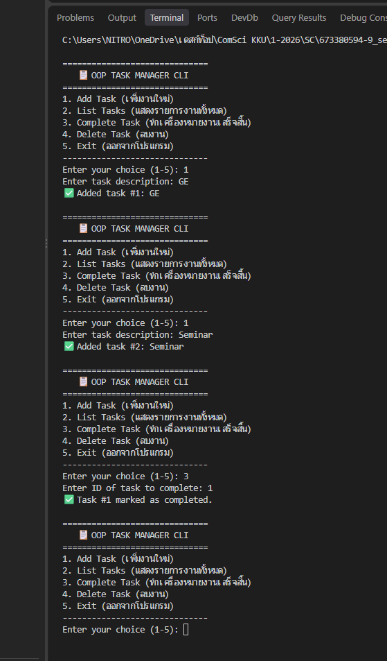

# Class Activity 2: OOP Task Manager

ปรับ [Task Manager จาก Class Activity 1](../../Activity%201/my-task-manager) ที่เขียนแบบ procedural (dict + ฟังก์ชันแยก) ให้เป็น OOP

## คลาส

**`Task`** (`src/task.py`) แทนงาน 1 รายการ
- attributes: `id`, `description`, `completed`
- `mark_complete()` เปลี่ยนสถานะเป็นเสร็จ
- `to_dict()` แปลงเป็น dict สำหรับบันทึก JSON
- `__str__` แสดงผลสำหรับผู้ใช้, `__repr__` แสดงผลสำหรับ debug

**`TaskManager`** (`src/task_manager.py`) จัดการรายการ Task ทั้งหมด
- attributes: `tasks` (list ของ Task), `next_id`
- `add_task()`, `list_tasks()`, `complete_task()`, `delete_task()`
- `_load_tasks()` / `_save_tasks()` แปลง JSON ↔ Task object อัตโนมัติ

## เทียบกับ Class Activity 1

| | Activity 1 (Procedural) | Activity 2 (OOP) |
|---|---|---|
| เก็บข้อมูลงาน | dict | `Task` object |
| ส่งข้อมูล | ส่ง list ไปมาระหว่างฟังก์ชัน | `TaskManager` เก็บไว้ใน `self.tasks` |
| บันทึกไฟล์ | เรียก `save_tasks()` ตอนออก | บันทึกทุกครั้งที่ข้อมูลเปลี่ยน |

## วิธีรัน

```
python main.py
python -m unittest discover -s tests
```

ผ่าน unit test ครบ 11 ข้อ

## ผลลัพธ์


