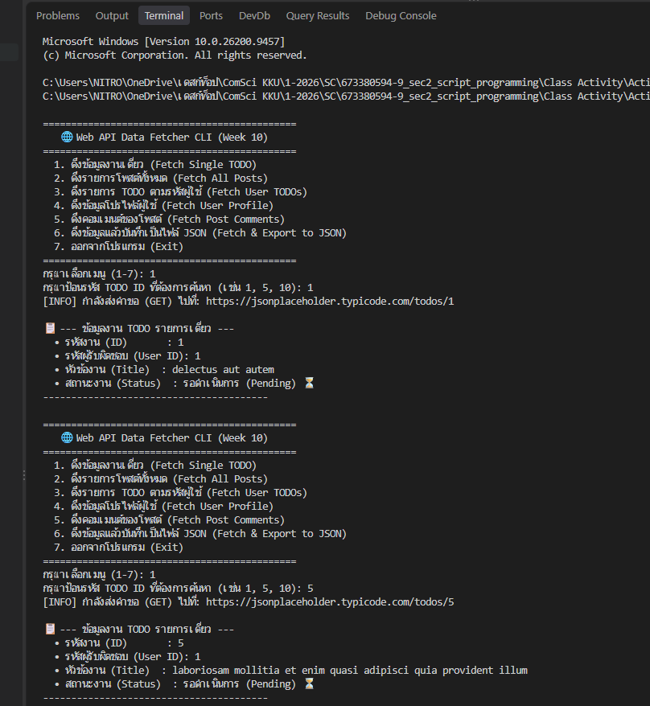
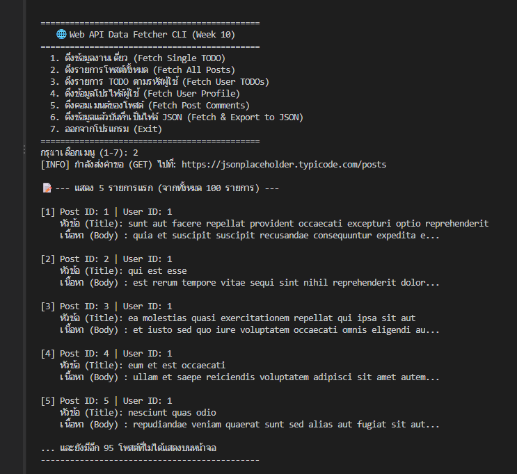
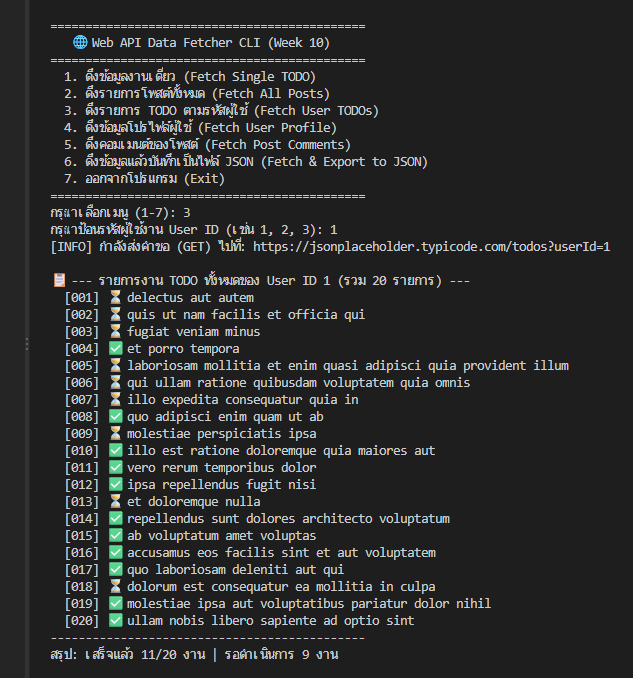

# Class Activity 3: Web API Data Fetcher

| | |
|---|---|
| ชื่อ-นามสกุล | นางสาวพรีมภัทร ภาวัฒนวคุณ (Preemphat Pawatnavakun) |
| รหัสนักศึกษา | 673380594-9 |
| กลุ่มเรียน | Section 2 |

โปรแกรม CLI ดึงข้อมูลจาก [JSONPlaceholder](https://jsonplaceholder.typicode.com/) ด้วย `requests` แปลง JSON แล้วแสดงผล พร้อมจัดการข้อผิดพลาดทั้งเครือข่ายและ input ของผู้ใช้

## เมนู

| # | ฟีเจอร์ | Endpoint |
|---|---|---|
| 1 | ดึง TODO รายการเดี่ยว | `GET /todos/{id}` |
| 2 | ดึงโพสต์ทั้งหมด (แสดง 5 รายการแรก) | `GET /posts` |
| 3 | ดึง TODO ของผู้ใช้ พร้อมสรุปเสร็จ/ค้าง | `GET /todos?userId={id}` |
| 4 | ดึงโปรไฟล์ผู้ใช้ (ชื่อ, username, อีเมล, เบอร์, บริษัท, เมือง) | `GET /users/{id}` |
| 5 | ดึงคอมเมนต์ของโพสต์ พร้อมจำนวนทั้งหมด | `GET /posts/{id}/comments` |
| 6 | ดึงข้อมูลแล้วบันทึกเป็นไฟล์ JSON ใน `output/` | |
| 7 | ออกจากโปรแกรม | |

เมนู 4-6 ทำเพิ่มตาม `assignment_guide.md` ของผู้สอน

## การจัดการข้อผิดพลาด

- เครือข่าย: ดักจับ `HTTPError`, `ConnectionError`, `Timeout`, `RequestException` และ JSON ที่แปลงไม่ได้
- ID ที่ไม่มีอยู่จริง (เช่น User ID 999) ได้ 404 โปรแกรมแจ้งเตือนแล้วกลับเมนู ไม่ crash
- input: ตรวจว่าเป็นจำนวนเต็มบวก ถ้าพิมพ์ตัวอักษรหรือเลขติดลบจะแจ้งเตือน
- บันทึกไฟล์: `utf-8`, `indent=4`, `ensure_ascii=False` และดักจับ `IOError`, `PermissionError`

## โครงสร้าง

```
my-api-fetcher/
├── src/
│   ├── __init__.py
│   └── api_client.py   # คลาส APIClient และฟังก์ชัน export_to_json_file
├── output/             # ไฟล์ JSON ที่บันทึกจากเมนู 6
├── screenshots/
├── main.py             # เมนู CLI และแสดงผล
└── requirements.txt
```

## วิธีรัน

```
pip install -r requirements.txt
python main.py
```

ต้องต่ออินเทอร์เน็ต

## ผลลัพธ์

**1. Fetch a Single TODO Item**


**2. Fetch All Posts**


**3. Fetch TODOs by User ID**

