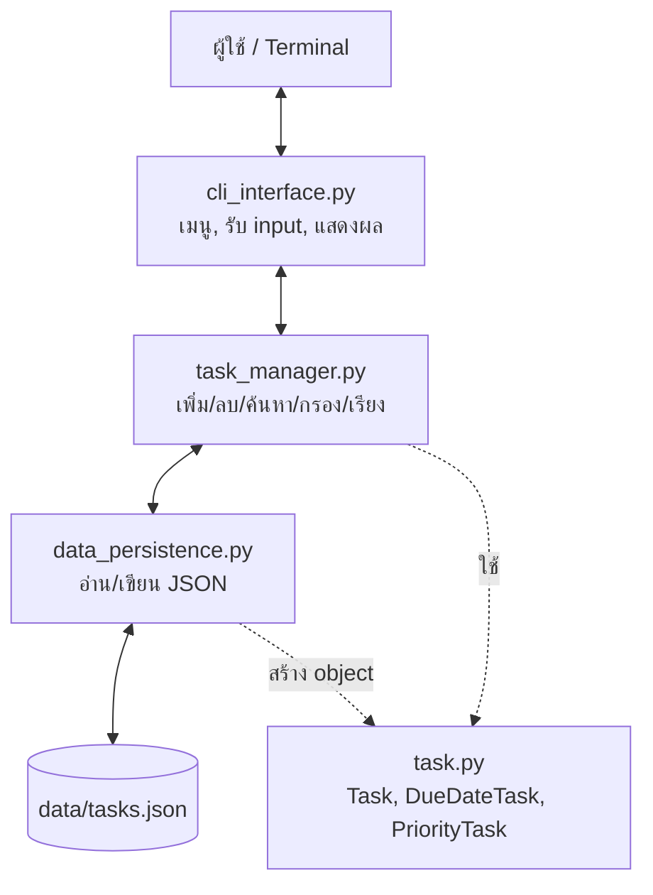
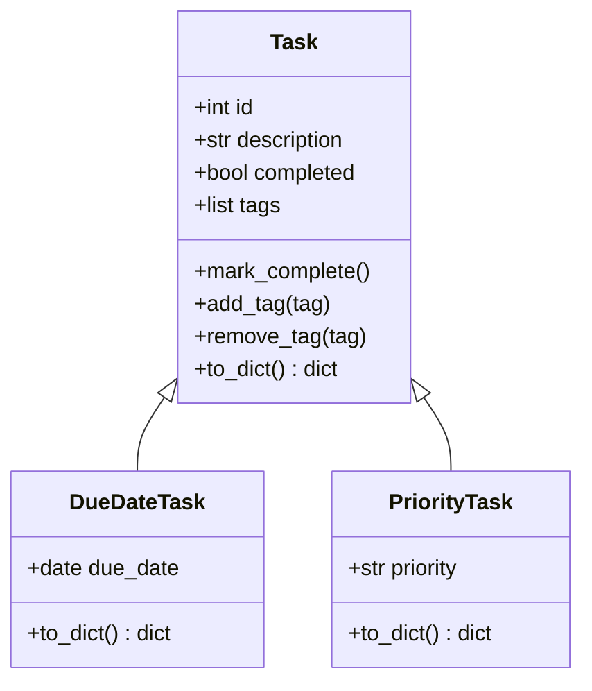

# Project Plan: Enhanced Task Manager CLI (Class Activity 4)

แผนออกแบบ Task Manager รุ่นถัดไป ก่อนลงมือเขียนจริงใน Lab 12 สัปดาห์นี้ทำแค่ **ออกแบบและวางโครง** (skeleton) ส่วน search, filter, sort ยังเป็น placeholder

## 1. ที่มา

Task Manager ผ่านมาแล้ว 2 รุ่น:
- **Class Activity 1** แบบ procedural: เก็บงานเป็น dict, ฟังก์ชันอยู่ใน `task_logic.py` กับ `task_data.py`
- **Class Activity 2** แบบ OOP: มีคลาส `Task` และ `TaskManager` แต่ `TaskManager` ยังทำทุกอย่าง ทั้งจัดการงาน อ่าน/เขียนไฟล์ และ print ผลลัพธ์

ปัญหาของรุ่นก่อน: ถ้าจะเพิ่ม tags, search, filter, sort ลงไปตรงๆ `TaskManager` จะใหญ่และแก้ยาก เลยต้องวางโครงใหม่ก่อน

## 2. Requirements

### 2.1 Functional Requirements

| # | ความต้องการ | สถานะสัปดาห์นี้ |
|---|---|---|
| F1 | เพิ่มงานได้ 3 แบบ: `Task`, `DueDateTask` (มีวันส่ง), `PriorityTask` (High/Medium/Low) | ✅ ทำได้ |
| F2 | ใส่ tags ได้หลายตัวต่องาน | ✅ ทำได้ |
| F3 | ดูงานทั้งหมด, ทำเครื่องหมายเสร็จ, ลบ | ✅ ทำได้ |
| F4 | ค้นหาคำในชื่องานและ tags | ⏳ placeholder (ทำใน Lab 12) |
| F5 | กรองตามสถานะ, วันส่ง, ความสำคัญ, tags | ⏳ placeholder |
| F6 | เรียงตาม ID, วันส่ง, ความสำคัญ | ⏳ placeholder |
| F7 | บันทึก/โหลดจาก `data/tasks.json` อัตโนมัติ | ✅ ทำได้ |

### 2.2 Non-Functional Requirements

- **Usability:** เมนูเลขชัดเจน ข้อความแจ้งเตือนเข้าใจง่าย
- **Reliability:** ใส่วันที่ผิดรูปแบบ, ID เป็นตัวอักษร หรือไฟล์ JSON เสีย โปรแกรมต้องไม่ crash
- **Maintainability:** แต่ละไฟล์มีหน้าที่เดียว อ่านแล้วรู้ว่าแก้ตรงไหน
- **Extensibility:** เพิ่มงานประเภทใหม่ (เช่น `RecurringTask`) หรือเปลี่ยนจาก JSON เป็น SQLite โดยไม่ต้องแก้ทุกไฟล์

## 3. Architecture

### 3.1 แบ่งเป็นชั้น (Separation of Concerns)



| โมดูล | หน้าที่ | ห้ามทำ |
|---|---|---|
| `task.py` | เก็บข้อมูลงานแต่ละชิ้น, แปลงเป็น dict | อ่าน/เขียนไฟล์, รับ input |
| `data_persistence.py` | อ่าน/เขียน `tasks.json` แปลงกลับเป็น object ตาม `_type` | ตัดสินใจเรื่องงาน |
| `task_manager.py` | logic ทั้งหมด: CRUD, search, filter, sort | `print` หรือ `input` |
| `cli_interface.py` | เมนู, ตรวจ input, แสดงผล | แก้ข้อมูลงานตรงๆ |
| `main.py` | สร้าง object แล้วเชื่อมกัน | logic ใดๆ |

กฎ "ห้ามทำ" นี้คือหัวใจของการออกแบบ ถ้าวันหนึ่งเปลี่ยนจาก CLI เป็นหน้าเว็บ จะแก้แค่ `cli_interface.py`

### 3.2 Class Diagram



### 3.3 รูปแบบข้อมูลใน JSON

```json
{"id": 3, "description": "Implement search", "completed": false,
 "tags": ["lab12"], "_type": "DueDateTask", "due_date": "2026-10-23"}
```

ฟิลด์ `_type` บอกว่าตอนโหลดต้องสร้างคลาสไหน ถ้าไม่มีฟิลด์นี้ ทุกงานจะกลายเป็น `Task` ธรรมดาและข้อมูลวันส่ง/ความสำคัญหาย

## 4. Implementation Plan

| ขั้น | งาน | สัปดาห์ |
|---|---|---|
| 1 | แยกไฟล์ตามโครงสร้างใหม่, ย้าย JSON ไป `data_persistence.py`, ย้าย print/input ไป `cli_interface.py` | Week 11 ✅ |
| 2 | เพิ่ม `tags` ใน `Task` และคลาสลูก | Week 11 ✅ |
| 3 | เขียน `search_tasks()` | Lab 12 |
| 4 | เขียน `filter_tasks()` แบบหลายเงื่อนไข | Lab 12 |
| 5 | เขียน `sort_tasks()` | Lab 12 |
| 6 | เขียน unit test | Lab 12 |

ผลของแผนนี้: [Lab 12 Enhanced Task Manager](../../../Lab/Week12/final-task-manager)

## 5. ความท้าทายที่คาดไว้

- **เรียงตามวันส่ง เมื่อบางงานไม่มีวันส่ง:** ต้องตัดสินใจว่างานแบบนี้ไปอยู่หัวหรือท้าย และเปรียบเทียบ object ต่างคลาสโดยไม่ error
- **เรียงตามความสำคัญ:** `High`, `Medium`, `Low` เรียงตามตัวอักษรจะผิด ต้องแปลงเป็นตัวเลขก่อน
- **กรองหลายเงื่อนไข:** ผู้ใช้อาจเลือกบางเงื่อนไขหรือไม่เลือกเลย ต้องข้ามเงื่อนไขที่เว้นว่างได้
- **เมนูซับซ้อนขึ้น:** ฟีเจอร์เพิ่ม เมนูยาวขึ้น ต้องคุมให้ใช้ง่าย

## 6. Future Enhancements

- แจ้งเตือนงานใกล้ถึงกำหนดส่งตอนเปิดโปรแกรม
- เก็บข้อมูลใน SQLite แทน JSON
- ส่งออกเป็น Excel หรือ CSV
- งานที่ทำซ้ำทุกสัปดาห์ (`RecurringTask`)
