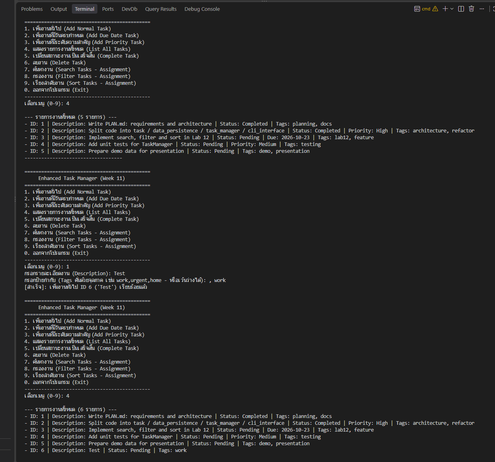

# Class Activity 4: Enhanced Task Manager Design (Week 11)

| | |
|---|---|
| ชื่อ-นามสกุล | นางสาวพรีมภัทร ภาวัฒนวคุณ (Preemphat Pawatnavakun) |
| รหัสนักศึกษา | 673380594-9 |
| กลุ่มเรียน | Section 2 |

ขั้นออกแบบของ Task Manager รุ่นถัดไป: วางโครงสร้างโมดูลใหม่ เพิ่ม tags และเตรียมช่องสำหรับ search, filter, sort ซึ่งยังเป็น placeholder รายละเอียดการออกแบบทั้งหมดอยู่ใน **[PLAN.md](PLAN.md)**

| รุ่น | งาน |
|---|---|
| 1 | [Class Activity 1](../../Activity%201/my-task-manager): procedural |
| 2 | [Class Activity 2](../../Activity%202/my-oop-task-manager): OOP |
| 3 | **Class Activity 4 (หน้านี้): ออกแบบโครงสร้างใหม่** |
| 4 | [Lab 12](../../../Lab/Week12/final-task-manager): สร้างจริงตามแผนนี้ |

## เมนู

| # | เมนู | สถานะ |
|---|---|---|
| 1-3 | เพิ่มงานทั่วไป / มีวันส่ง / มีความสำคัญ (พร้อม tags) | ✅ |
| 4 | แสดงงานทั้งหมด | ✅ |
| 5 | ทำเครื่องหมายเสร็จ | ✅ |
| 6 | ลบงาน | ✅ |
| 7-9 | ค้นหา / กรอง / เรียง | ⏳ placeholder |
| 0 | ออก | ✅ |

## โครงสร้าง

```
enhanced-task-manager-design/
├── src/
│   ├── task.py               # Task, DueDateTask, PriorityTask (มี tags)
│   ├── data_persistence.py   # อ่าน/เขียน JSON
│   ├── task_manager.py       # business logic (search/filter/sort เป็น placeholder)
│   └── cli_interface.py      # เมนูและ input/output
├── data/tasks.json
├── screenshots/
├── main.py
├── PLAN.md
└── README.md
```

## วิธีรัน

```
python main.py
```

ใช้แค่ library มาตรฐานของ Python

## ผลลัพธ์


