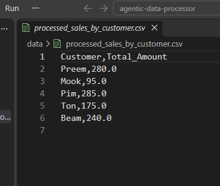
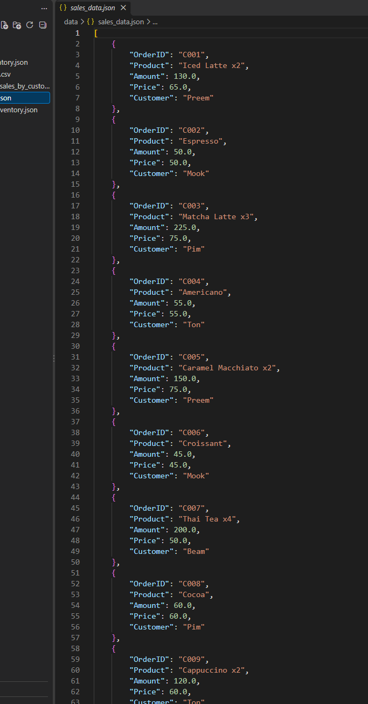
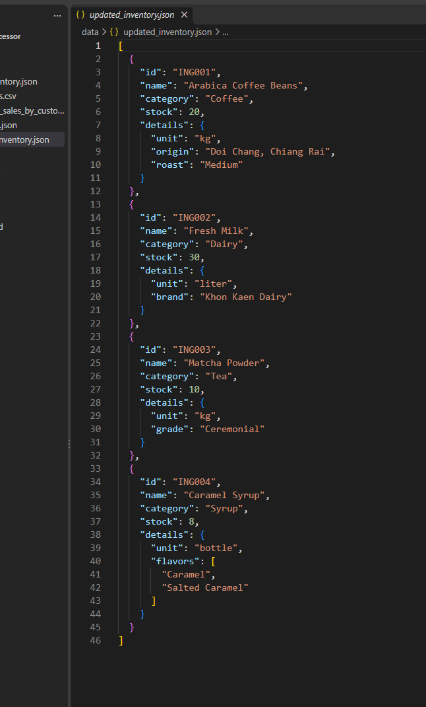

# Lab 2 Advance (Week 8): Agentic Data Processor

ต่อยอดจาก [Lab 2 Basic](../../../Lab%20X%20Basic/Lab%202%20Basic/data-processor) ด้วยข้อมูลร้านกาแฟชุดเดียวกัน แต่เปลี่ยนจากเขียนขั้นตอนตายตัวใน `main.py` เป็นให้ `DataAgent` อ่านลำดับงานจากไฟล์ config แล้วทำทีละขั้น ส่งข้อมูลระหว่างขั้นผ่าน `data_store`

## Pipeline (`configs/data_pipeline_config.json`)

| # | Task | ผลลัพธ์ |
|---|---|---|
| 1 | `load_csv` โหลดยอดขาย | `raw_sales_data` |
| 2 | `transform_csv_aggregate` รวมยอดตามลูกค้า | `customer_sales_summary` |
| 3 | `save_csv` | `data/processed_sales_by_customer.csv` |
| 4 | `csv_to_json_conversion` แปลงยอดขายเป็น JSON | `raw_sales_json` |
| 5 | `save_json` | `data/sales_data.json` |
| 6 | `load_json` โหลดสต็อกวัตถุดิบ | `raw_inventory_data` |
| 7 | `update_json_data` เติมสต็อกเมล็ดกาแฟและมัทฉะ, แก้ยี่ห้อนม, เพิ่มระดับการคั่ว, เพิ่ม Caramel Syrup | `updated_inventory_data` |
| 8 | `query_json_data` ดึงแหล่งปลูกของเมล็ดกาแฟ (`0.details.origin`) | `queried_bean_origin` |
| 9 | `save_json` | `data/updated_inventory.json` |

ทุกขั้นถูกบันทึกลง audit report ใน `reports/audit_report_<วันเวลา>.json`

## โครงสร้าง

```
agentic-data-processor/
├── src/
│   ├── data_agent.py         # อ่าน config, เลือก handler ตามประเภทงาน, เก็บ data_store
│   ├── csv_tasks.py          # load / aggregate / save CSV
│   ├── json_tasks.py         # load / update / query / save JSON
│   ├── conversion_tasks.py   # CSV <-> JSON
│   ├── config_parser.py      # โหลดและตรวจ config
│   └── utils.py              # logging และ audit log
├── configs/data_pipeline_config.json
├── data/                     # input และ output
├── reports/                  # audit report
├── screenshots/
└── main.py
```

## วิธีรัน

```
python main.py
```

ใช้แค่ library มาตรฐานของ Python

## ผลลัพธ์






