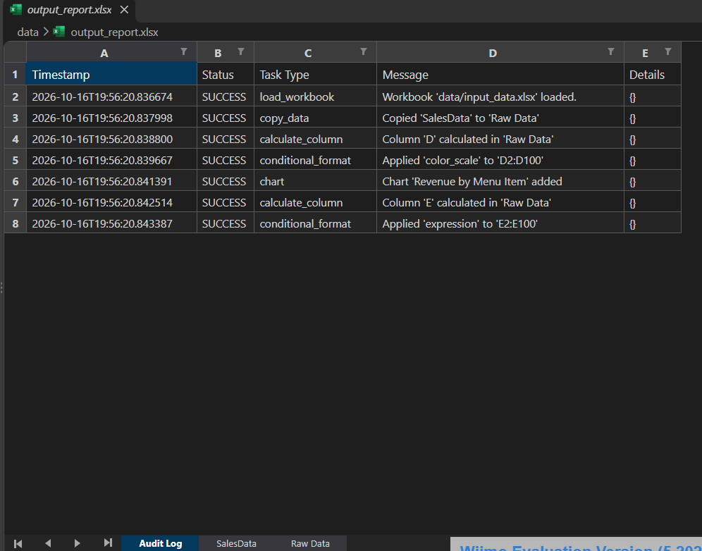
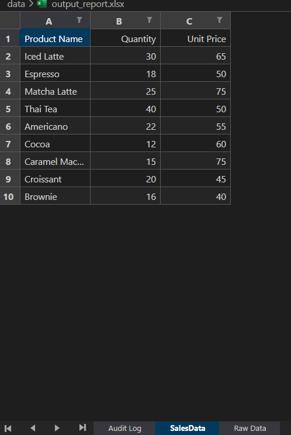
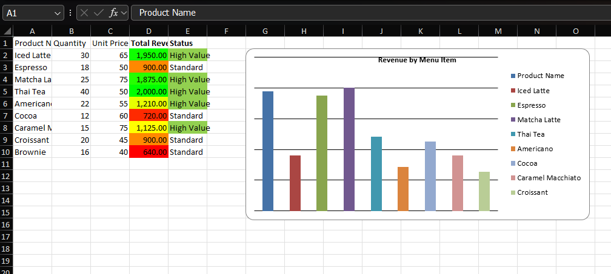

# Lab 3 Advance (Week 10): Spreadsheet Agent

ต่อยอดจาก [Lab 3 Basic](../../../Lab%20X%20Basic/Lab%203%20Basic/spreadsheet-automator) ด้วยข้อมูลยอดขายร้านกาแฟ แต่ให้ `SpreadsheetAgent` อ่านลำดับงานจากไฟล์ config แล้วทำทีละขั้น พร้อมบันทึกทุกขั้นลงชีต Audit Log

## Pipeline (`configs/example_spreadsheet_config.json`)

| # | Task | ทำอะไร |
|---|---|---|
| 1 | `copy_data` | คัดลอกชีต SalesData ไปเป็นชีต Raw Data |
| 2 | `calculate_column` | คอลัมน์ D Total Revenue = Quantity × Unit Price (สูตร Excel) |
| 3 | `conditional_format` | ไล่สี D แดง → เหลือง → เขียว ตามยอดขาย |
| 4 | `chart` | กราฟแท่งยอดขายแต่ละเมนู |
| 5 | `calculate_column` | คอลัมน์ E Status: เกิน 1,000 บาทเป็น High Value ไม่งั้นเป็น Standard |
| 6 | `conditional_format` | ไฮไลต์สีเขียวแถวที่เป็น High Value |

ผลลัพธ์ `data/output_report.xlsx` มี 3 ชีต: **Audit Log**, **SalesData** (ข้อมูลต้นฉบับ), **Raw Data** (ข้อมูลที่ประมวลผลแล้ว + กราฟ)

## โครงสร้าง

```
spreadsheet-agent/
├── src/
│   ├── spreadsheet_agent.py   # อ่าน config, เลือก handler ตามประเภทงาน, เขียน Audit Log
│   ├── config_parser.py       # โหลดและตรวจ config
│   └── utils.py               # logging
├── configs/example_spreadsheet_config.json
├── data/
├── screenshots/
├── create_dummy_data.py       # สร้าง data/input_data.xlsx
├── main.py
└── requirements.txt
```

## วิธีรัน

```
pip install -r requirements.txt
python create_dummy_data.py
python main.py
```

รันจากในโฟลเดอร์ `spreadsheet-agent`

## ผลลัพธ์

**Audit Log**


**SalesData**


**Raw Data**

