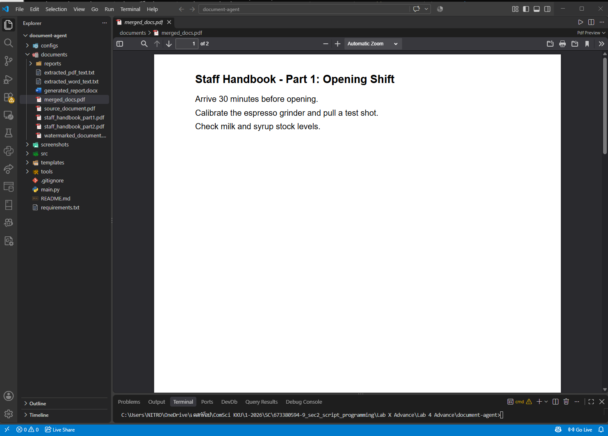
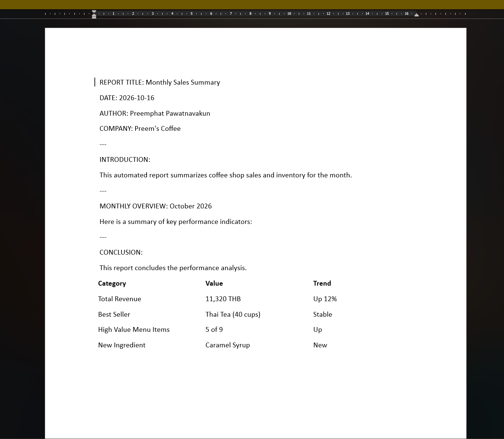
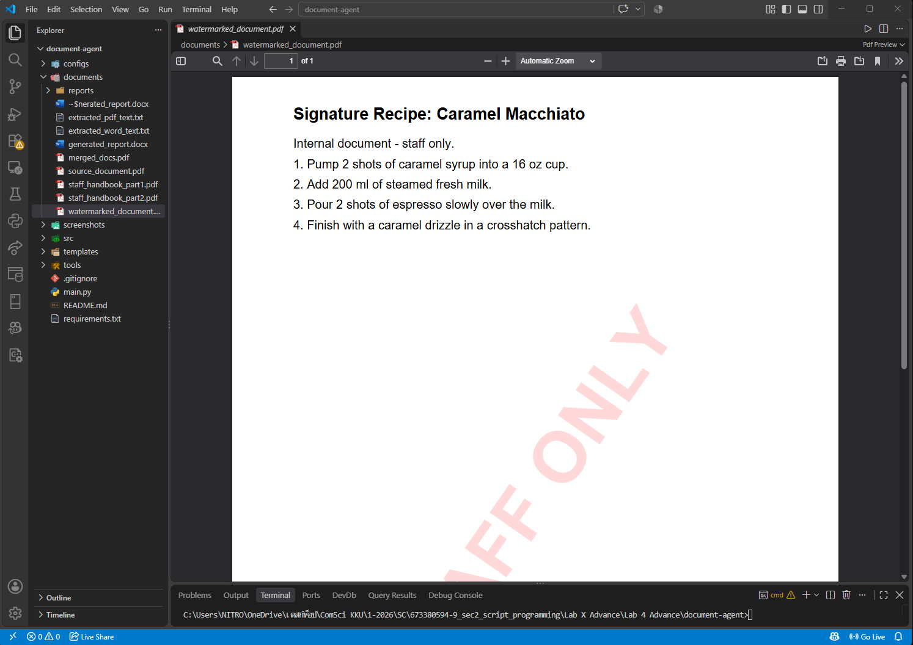

# Lab 4 Advance (Week 11): Document Agent

ต่อยอดจาก [Lab 4 Basic](../../../Lab%20X%20Basic/Lab%204%20Basic/document-automator) ให้ `DocumentAgent` อ่านลำดับงานจาก config แล้วจัดการเอกสาร PDF และ Word ของร้านกาแฟอัตโนมัติ พร้อมบันทึก audit report

คลิปการสอน: https://drive.google.com/file/d/1NnSoPx1C3hzNyUBZ_pJvpC1OqFJ2I6rQ/view?usp=sharing

## Pipeline (`configs/document_automation_config.json`)

| # | Task | ทำอะไร | Output |
|---|---|---|---|
| 1 | `generate_word_report` | เติมข้อมูลลง template Word (`{{REPORT_TITLE}}` ฯลฯ) และแทรกตารางสรุปยอดขาย | `documents/generated_report.docx` |
| 2 | `apply_pdf_watermark` | ใส่ลายน้ำ "STAFF ONLY" บนสูตรเครื่องดื่ม | `documents/watermarked_document.pdf` |
| 3 | `merge_pdfs` | รวมคู่มือพนักงาน 2 ส่วนเป็นไฟล์เดียว | `documents/merged_docs.pdf` |
| 4 | `extract_word_text` | ดึงข้อความจากรายงาน Word | `documents/extracted_word_text.txt` |
| 5 | `extract_pdf_text` | ดึงข้อความจาก PDF สูตร | `documents/extracted_pdf_text.txt` |

ทุกขั้นบันทึกลง `documents/reports/audit_report_<วันเวลา>.json`

## ที่แก้จากโค้ดต้นฉบับ

โค้ดเดิมส่ง key ของ placeholder เป็น `REPORT_TITLE` แต่ใน template เขียนเป็น `{{REPORT_TITLE}}` ผลคือในรายงานยังมีวงเล็บปีกกาค้าง เช่น `{{Monthly Sales Summary}}` แก้ใน `src/document_agent.py` ให้ห่อ key เป็น `{{KEY}}` ก่อนแทนค่า

## โครงสร้าง

```
document-agent/
├── src/
│   ├── document_agent.py   # อ่าน config, เลือก handler, เขียน audit report
│   ├── word_tasks.py       # เติม template, ดึงข้อความ Word
│   ├── pdf_tasks.py        # ลายน้ำ, รวม PDF, ดึงข้อความ PDF
│   ├── config_parser.py
│   └── utils.py
├── configs/document_automation_config.json
├── templates/report_template.docx
├── documents/              # PDF ต้นฉบับ และ output
├── tools/create_sample_pdfs.py
├── screenshots/
├── main.py
└── requirements.txt
```

## วิธีรัน

```
pip install -r requirements.txt
python main.py
```

## ผลลัพธ์

**merged_docs.pdf**


**generated_report.docx**


**watermarked_document.pdf**

