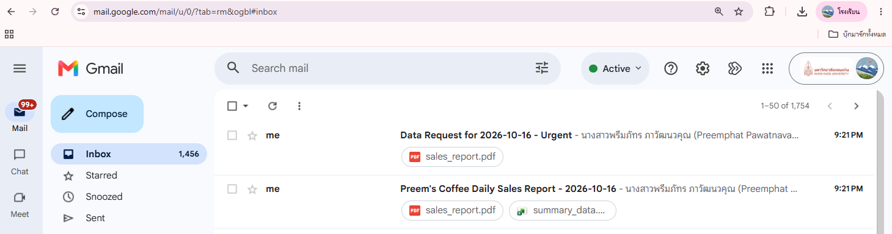

# Lab 5 Advance (Week 12): Agentic Communication Automator

ต่อยอดจาก [Lab 5 Basic](../../../Lab%20X%20Basic/Lab%205%20Basic/email-sms-automator) ให้ `CommunicationAgent` อ่านลำดับงานสื่อสารจาก config สร้างเนื้อหาอีเมลแบบ dynamic จาก context และจัดการกล่องจดหมายตามกฎ if-then

คลิปการสอน: https://drive.google.com/file/d/1IQG5n4ZtnCZXstkHJfyGHwmwLuJx7XBq/view?usp=sharing

## Pipeline (`configs/comm_pipeline_config.json`)

| # | Task | ทำอะไร |
|---|---|---|
| 1 | `send_email` | ส่งรายงานยอดขายประจำวันของร้านกาแฟ แนบ `sales_report.pdf` และ `summary_data.xlsx` หัวเรื่องและเนื้อหาเติมจาก context (`{report_date}`, `{sales_figure}`, `{best_seller}`) |
| 2 | `send_email` | จำลองอีเมลขอข้อมูลแบบด่วน ส่งหาตัวเอง |
| 3 | `process_inbox` | ค้นหาอีเมลที่ยังไม่อ่านหัวเรื่องมี "Data Request" ดาวน์โหลดไฟล์แนบ แล้วใช้กฎ: |
| | กฎ 1 | หัวเรื่องมี "Urgent" และมีไฟล์แนบ → ส่ง SMS แจ้งเตือน |
| | กฎ 2 | เนื้อหามี "new data processing" → ตอบกลับอีเมลอัตโนมัติ |

ทุกขั้นบันทึกลง `reports/audit_report_comm_<วันเวลา>.json`

## ที่แก้จากโค้ดต้นฉบับ

- อีเมลผู้รับในโค้ดเดิมต้องพิมพ์ลงใน config ตรงๆ เปลี่ยนเป็น `{sender_email}` และ `{recipient_email}` ที่ agent อ่านจาก `.env` อีเมลจริงจึงไม่ขึ้น GitHub
- เพิ่ม `{student_info}` (ชื่อ-นามสกุลและรหัสนักศึกษา) ในเนื้อหาอีเมลทุกฉบับ
- เพิ่ม `requirements.txt` และ `.env.example`

**SMS:** gateway เป็นของผู้ให้บริการในสหรัฐฯ ผู้ให้บริการในไทยไม่รองรับ จึงส่งไม่ถึงมือถือจริง

## ตั้งค่าและรัน

```
copy .env.example .env      # แล้วใส่อีเมลและ App Password ของตัวเอง
pip install -r requirements.txt
python main.py
```

`.env` ถูกกันไว้ใน `.gitignore` ห้าม commit

## โครงสร้าง

```
agentic-comm-automator/
├── src/
│   ├── communication_agent.py   # อ่าน config, เก็บ context, ทำงานตามกฎ, audit log
│   ├── email_tasks.py           # SMTP / IMAP
│   ├── sms_tasks.py             # SMS ผ่าน email gateway
│   ├── template_renderer.py     # เติม {placeholder} จาก context
│   ├── config_parser.py
│   └── utils.py
├── configs/comm_pipeline_config.json
├── data/reports/                # sales_report.pdf, summary_data.xlsx
├── screenshots/
├── .env.example
├── main.py
└── requirements.txt
```

## ผลลัพธ์


