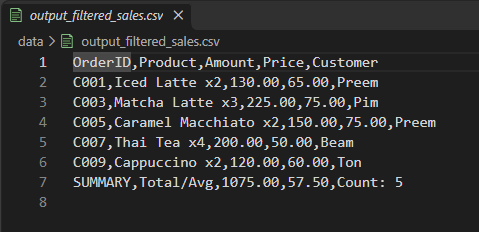
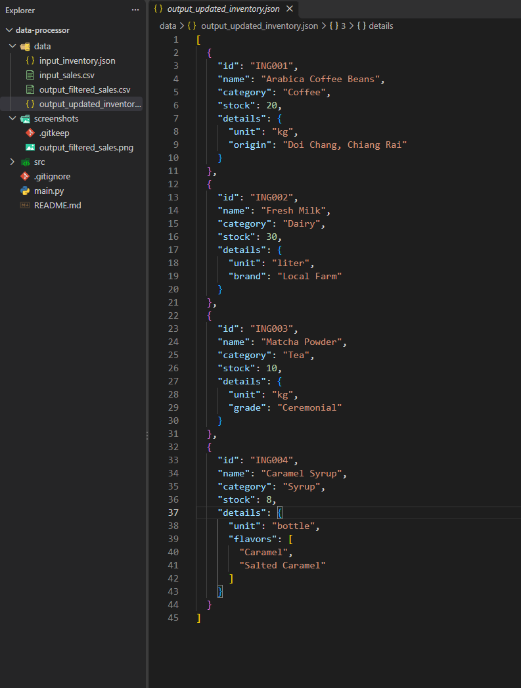

# Lab 2 Basic (Week 8): Data Processor — CSV & JSON

โปรแกรมประมวลผลข้อมูลร้านกาแฟ อ่านยอดขายจาก CSV และสต็อกวัตถุดิบจาก JSON แล้วเขียนผลลัพธ์เป็นไฟล์ใหม่ เขียนแบบ OOP แยกเป็นคลาส `CSVHandler` และ `JSONHandler`

## สิ่งที่โปรแกรมทำ

**CSV (ยอดขาย)**
1. อ่าน `data/input_sales.csv` ด้วย `csv.DictReader`
2. คำนวณยอดขายรวมและราคาเฉลี่ยต่อรายการ
3. กรองออเดอร์ที่ยอด ≥ 100 บาท
4. เขียนผลพร้อมแถวสรุปลง `data/output_filtered_sales.csv` ด้วย `csv.DictWriter`

**JSON (สต็อกวัตถุดิบ)**
1. อ่าน `data/input_inventory.json` ด้วย `json.load`
2. เติมสต็อกเมล็ดกาแฟ (ING001) และผงมัทฉะ (ING003)
3. เพิ่มวัตถุดิบใหม่ Caramel Syrup (ING004)
4. เขียนผลลง `data/output_updated_inventory.json` ด้วย `json.dump` แบบ `indent=2`

## โครงสร้าง

```
data-processor/
├── src/
│   ├── __init__.py
│   ├── csv_handler.py     # อ่าน/เขียน/ประมวลผล CSV
│   ├── json_handler.py    # อ่าน/เขียน/อัปเดต JSON
│   └── utils.py           # logging และสร้างโฟลเดอร์
├── data/                  # ไฟล์ input และ output
├── screenshots/           # ภาพผลลัพธ์
├── main.py
└── .gitignore
```

## วิธีรัน

```
python main.py
```

ใช้แค่ library มาตรฐานของ Python ไม่ต้องติดตั้งอะไรเพิ่ม

## ผลลัพธ์




