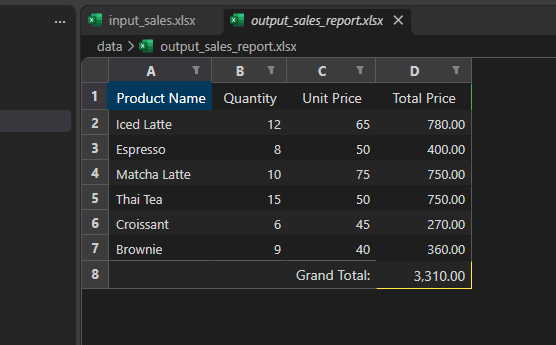

# Lab 3 Basic (Week 10): Spreadsheet Automator

อ่านยอดขายเมนูร้านกาแฟจากไฟล์ Excel คำนวณยอดรวมแต่ละรายการและยอดรวมทั้งหมด แล้วสร้างรายงาน Excel ใหม่พร้อมจัดรูปแบบ ใช้ `openpyxl`

## สิ่งที่โปรแกรมทำ

1. โหลด `data/input_sales.xlsx` (คอลัมน์ Product Name, Quantity, Unit Price)
2. ข้ามแถวว่าง และคำนวณ Total Price = Quantity × Unit Price
3. คำนวณ Grand Total
4. เขียน `data/output_sales_report.xlsx` พร้อมจัดหัวตารางตัวหนา ใส่สีแถวยอดรวม และจัดรูปแบบตัวเลข

## โครงสร้าง

```
spreadsheet-automator/
├── src/
│   ├── __init__.py
│   └── excel_processor.py   # คลาส ExcelProcessor: โหลด สร้าง เขียน จัดรูปแบบ Excel
├── data/
│   ├── input_sales.xlsx
│   └── output_sales_report.xlsx
├── screenshots/
├── main.py
├── requirements.txt
└── .gitignore
```

## วิธีรัน

```
pip install -r requirements.txt
python main.py
```

ต้องรันจากในโฟลเดอร์ `spreadsheet-automator` เพราะโปรแกรมอ้างถึงโฟลเดอร์ `data/` แบบ relative path

## ผลลัพธ์


