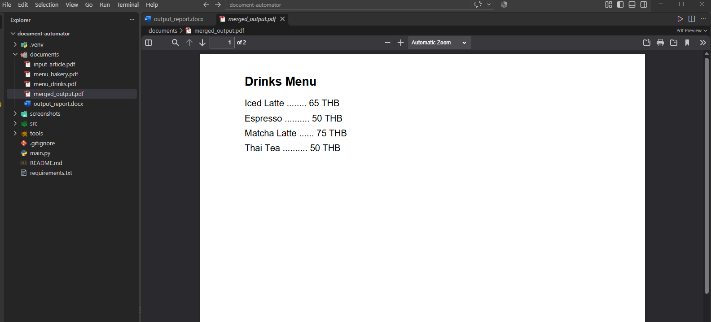
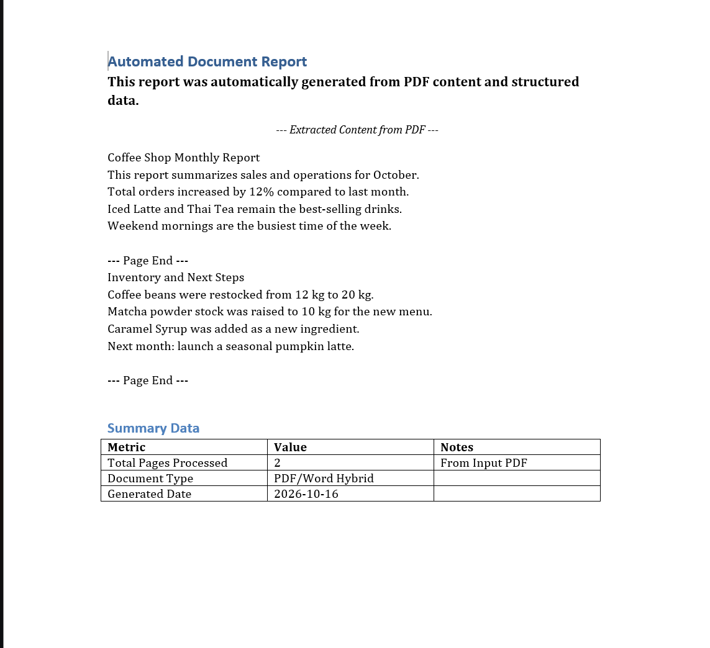

# Lab 4 Basic (Week 11): Document Automator

อ่านรายงานประจำเดือนของร้านกาแฟจาก PDF แล้วสร้างรายงาน Word ใหม่ และรวมเมนูเครื่องดื่มกับเมนูเบเกอรี่เป็น PDF ไฟล์เดียว

## สิ่งที่โปรแกรมทำ

**Task 1: PDF → Word**
1. ดึงข้อความจาก `documents/input_article.pdf` ด้วย `PyPDF2`
2. สร้าง `documents/output_report.docx` ด้วย `python-docx` มีหัวข้อ, ย่อหน้าจัดรูปแบบ (ตัวหนา/ตัวเอียง/จัดกลาง), ข้อความที่ดึงมา และตารางสรุป

**Task 2: รวม PDF**
- รวม `menu_drinks.pdf` กับ `menu_bakery.pdf` เป็น `documents/merged_output.pdf`

## โครงสร้าง

```
document-automator/
├── src/
│   ├── pdf_processor.py    # คลาส PDFProcessor: ดึงข้อความ, รวม PDF
│   ├── word_processor.py   # คลาส WordProcessor: หัวข้อ, ย่อหน้า, ตาราง, บันทึก
│   └── utils.py            # logging, สร้างโฟลเดอร์
├── documents/              # PDF ต้นฉบับ และไฟล์ output
├── tools/
│   └── create_sample_pdfs.py   # สร้าง PDF ตัวอย่างใน documents/
├── screenshots/
├── main.py
└── requirements.txt
```

## วิธีรัน

```
python -m venv .venv
.\.venv\Scripts\Activate.ps1
pip install -r requirements.txt
python main.py
```

PDF ตัวอย่างมีให้แล้ว ถ้าอยากสร้างใหม่รัน `python tools/create_sample_pdfs.py`

## ผลลัพธ์

**merged_output.pdf**


**output_report.docx**

