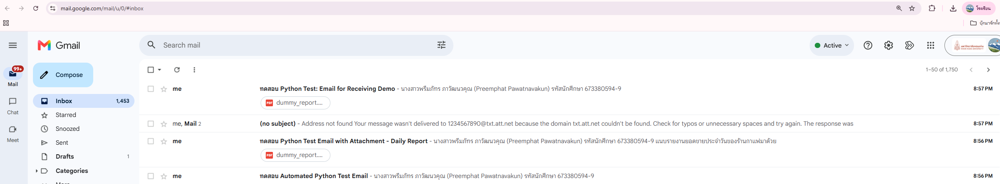

# Lab 5 Basic (Week 12): Email & SMS Automator

ส่งและรับอีเมลอัตโนมัติด้วย Python (`smtplib`, `imaplib`) และส่ง SMS ผ่าน email-to-SMS gateway โดยเก็บรหัสผ่านไว้ในไฟล์ `.env` ไม่เขียนลงในโค้ด

## สิ่งที่โปรแกรมทำ

| Task | ทำอะไร |
|---|---|
| 1 | ส่งอีเมลข้อความธรรมดา |
| 2 | ส่งอีเมลแนบไฟล์รายงานยอดขาย `data/dummy_report.pdf` |
| 3 | ส่ง SMS ผ่าน email gateway |
| 4 | ส่งอีเมลหาตัวเอง แล้วเชื่อม IMAP ค้นหาอีเมลที่ยังไม่อ่าน แสดงผู้ส่ง/หัวเรื่อง/เนื้อหา ดาวน์โหลดไฟล์แนบลง `data/attachments/` และทำเครื่องหมายว่าอ่านแล้ว |

เนื้อหาอีเมลทุกฉบับมีชื่อ-นามสกุลและรหัสนักศึกษา (ตัวแปร `STUDENT_INFO` ใน `main.py`)

**หมายเหตุ Task 3:** gateway ที่รองรับในโค้ดเป็นของผู้ให้บริการในสหรัฐฯ (AT&T, Verizon ฯลฯ) ผู้ให้บริการในไทยไม่รองรับ SMS ผ่านอีเมล จึงส่งไม่ถึงมือถือจริง

## ตั้งค่า

1. เปิด 2-Step Verification ใน Google Account แล้วสร้าง **App Password**
2. คัดลอก `.env.example` เป็น `.env` แล้วใส่อีเมลและ App Password ของตัวเอง
3. `.env` ถูกกันไว้ใน `.gitignore` ห้าม commit ขึ้น GitHub

## วิธีรัน

```
pip install -r requirements.txt
python main.py
python -m unittest discover -s tests
```

unit test ใช้ mock ไม่ต้องต่อเน็ตหรือใส่รหัสผ่าน (ผ่าน 18 ข้อ)

## โครงสร้าง

```
email-sms-automator/
├── src/
│   ├── email_sender.py     # ส่งอีเมล SMTP (ข้อความ, HTML, ไฟล์แนบ)
│   ├── email_receiver.py   # รับอีเมล IMAP (ค้นหา, อ่าน, ดาวน์โหลดไฟล์แนบ)
│   ├── sms_gateway.py      # ส่ง SMS ผ่าน email gateway
│   └── utils.py            # logging, โหลด .env
├── data/
│   ├── dummy_report.pdf
│   └── attachments/
├── tests/test_automator.py
├── screenshots/
├── .env.example
├── main.py
└── requirements.txt
```

## ผลลัพธ์


