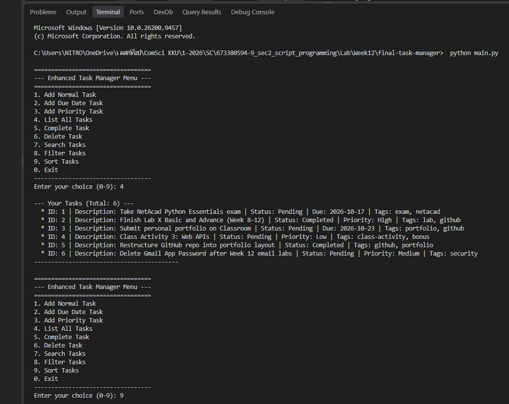
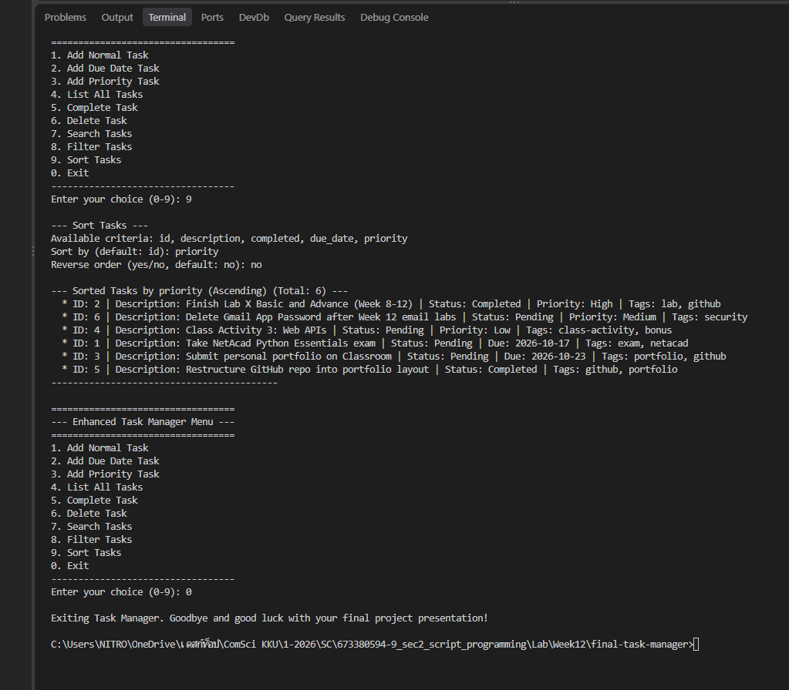

# Lab 12: Enhanced Task Manager CLI

Task Manager ฉบับสมบูรณ์ ต่อยอดจาก [Class Activity 1](../../../Class%20Activity/Activity%201/my-task-manager) (procedural) และ [Class Activity 2](../../../Class%20Activity/Activity%202/my-oop-task-manager) (OOP) เพิ่มประเภทงาน, tags, ค้นหา, กรอง และเรียงลำดับ

รายละเอียดการออกแบบ ปัญหาที่เจอ และบทเรียนที่ได้ อยู่ใน [PLAN.md](PLAN.md)

## เมนู

```
1. Add Normal Task        6. Delete Task
2. Add Due Date Task      7. Search Tasks
3. Add Priority Task      8. Filter Tasks
4. List All Tasks         9. Sort Tasks
5. Complete Task          0. Exit
```

## วิธีรัน

```
python main.py
python -m unittest discover tests
```

ใช้แค่ library มาตรฐานของ Python มีข้อมูลตัวอย่างใน `data/tasks.json` เป็นงานเรียนของฉันเอง

## ผลลัพธ์



